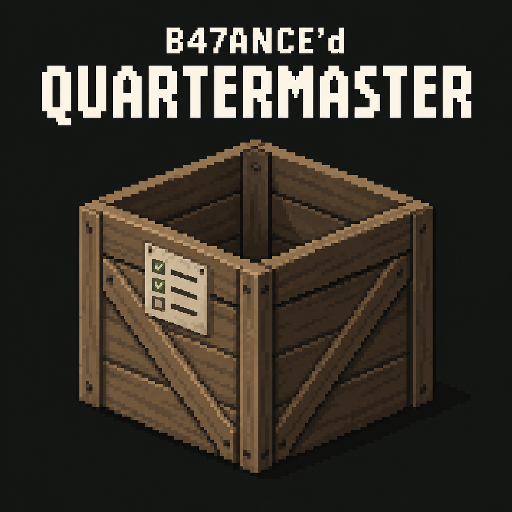

# B47ANCE'd Quartermaster

Shared UI source iteration: requires [B47ANCEDUI](https://github.com/B47ANCE/B47ANCEDUI) public client API 1 in addition to Rooms and PC Framework. Subscribe to [B47ANCE'd UI](https://steamcommunity.com/sharedfiles/filedetails/?id=3822582242) on every peer. [Extraction, migration and actual validation limits](docs/UI_EXTRACTION.md).



Organize storage, put supplies away and keep track of what you need in Project Zomboid.

Tell each container what belongs inside, then sort your inventory, a room or an entire building from one menu.

[Get Quartermaster on Steam Workshop](https://steamcommunity.com/sharedfiles/filedetails/?id=3807217050) | [Required: B47ANCE'd Rooms](https://steamcommunity.com/sharedfiles/filedetails/?id=3820077442)

This source is developed as **0.24.0-dev.4**. It uses B47ANCE'd UI API 1 for Quartermaster-owned controls and menus; Stock and Base Ledger remain available as described below. The [0.23.0-dev.1 upload receipt](docs/WORKSHOP_STOCK_TESTING_2026_10_18.md) remains historical evidence. Distribution is separate from native acceptance. Native client/dedicated acceptance for this build remains pending. Requires [B47ANCE'd Rooms](https://steamcommunity.com/sharedfiles/filedetails/?id=3820077442) and [B47ANCED PC Framework](https://steamcommunity.com/sharedfiles/filedetails/?id=3822042011) on every peer.

## Stock and connected computers

Set shared room/building item targets from **Stock** in the normal Quartermaster menu. Paper and PC ledgers show Current / Target / Remaining; personal Dibs! Needed stays separate. The PC app automatically posts low-stock notifications only from complete, fresh live data.

Choose This CD, Latest local CDs or Base ledger in the digital reader. Newest completed copies cover each area once. Connect PCs using the Framework's PC Network app: start pairing on one, visit another and enter its address, or connect to a public PC. Network Status shows online and offline/unavailable computers. A live remote building needs a loaded, powered, accessible PC with Quartermaster installed and its own local ledger CD. When it is unavailable, bring a completed CD from that building to this PC to read its dated, partial offline history. Refresh the paper ledger in the source building, then rewrite the matching-area CD at its PC or burn a new blank disc. Connections never bypass access rules or simulate unloaded inventory.

The earlier Stock/ledger offline combination used PC Framework **0.11.0-dev.1**, Rooms **0.2.0-dev.7** and UI **0.3.0-dev.1**. The menu integration is tested offline against UI **0.5.0-dev.11**, still public API 1. [Workflow, settings, authority, persistence and acceptance limits](docs/STOCK_AND_BASE_LEDGER.md).

## Current integrated features

The approved transparent crate/checklist is the mod icon. The Workshop thumbnail and poster remain unchanged. The shared computer desktop keeps separate ledger/writer windows, and writer results stay with the originating window.

Dev.4 closes native confirmation failures through the normal result callback, so rejected/timed-out actions show their reason and the installer can retry. If computer notification fails after installation, the server keeps the installed receipt, retires the action and explicitly reports synchronization pending; the installer prevents duplicate installation while waiting. [Failure-path validation](docs/APPLICATION_CD.md#0210-dev4-confirmation-and-notification-correction).

The dev.3 polish checkpoint fixes lost-ledger discovery, returns to the original Sort source after ledger pickup, clears interrupted writing work, preserves ledger save warnings in the final Sort message, releases the installer drive, and repairs fallback Shopping paper layout/controller access. Native transfer grouping, recipes and saved-data schemas are unchanged. [Audit findings, fixes and acceptance checks](docs/SORT_LEDGER.md#0210-dev3-polish-checkpoint).

**Sort and update the paper ledger** (default on): carry a pen or pencil. Quartermaster first searches accessible loaded building storage for a completed ledger covering the work location and picks it up using a normal native transfer. If none is found, it uses a carried blank or unfinished Supply Sheet. After the entire successful inventory/container/room/building Sort, one timed writing action records confirmed touched storage. Blank sheets remain partial, unvisited entries retain their old inspection time, and existing ledger CDs keep their snapshots. Server option `SortUpdatesLedger` restores the previous workflow when off; Disabled Ledger mode bypasses it. [Workflow, authority, limits and tests](docs/SORT_LEDGER.md).

Find a **Quartermaster Application CD** in commercial office desks/counters, office supply shelves/crates or computer retail/stock containers (including warehouse offices that use native office loot). Put it in accessible storage beside a powered PC, open **Quartermaster Setup**, load the CD in **CD-ROM (D:)** and run **SETUP.EXE**. Choose **Install Quartermaster** and complete the native action. Installation belongs to that PC and survives a service reload; the reusable Application CD stays in storage. Successful installation automatically releases its setup-drive binding, leaving the reusable disc in storage. Open Quartermaster to write/read ledger CDs; the Application CD no longer needs to stay nearby. Existing PCs require installation by default; server sandbox settings control the prerequisite, install time and new-loot weight. [Workflow, authority, persistence and validation](docs/APPLICATION_CD.md).

The computer desktop and reusable drive service are supplied by the required [B47ANCED PC Framework](https://github.com/B47ANCE/B47ANCEDPCFramework). Use paired development companion 0.11.0-dev.1 for the unified desktop, CD program, connections and notification APIs 1; Quartermaster owns the ledger and CD Writer apps. [Dependency details](docs/PC_FRAMEWORK_INTEGRATION.md).

- Windows ’93 computer presentation now has a bulky original beige CRT case, thick recessed bezel, broad lower control panel, substantial stand and status light and pixel-art desktop/application icons. Softer case shading and a working taskbar retain separate drive, writer and ledger tasks, with minimize/restore, app switching and Show Desktop. The ledger application uses a Windows 93 table with Item, Quantity and Location columns, a live/snapshot status strip, page counts and selected-entry details. Native visual acceptance remains pending. [Computer UI details](docs/WINDOWS93_COMPUTER.md).

- Paper supply ledgers open a portrait wooden clipboard with a beveled steel clamp gripping the page and scroll-aligned ruled sheets, Item / Quantity / Location columns, entry details and previous/next-sheet controls. Computers refresh live inventory only inside the exact native building recorded by the loaded ledger; off-site and safehouse-wide CDs remain historical under normal expiry. [Clipboard and local-computer policy](docs/CLIPBOARD_AND_LOCAL_COMPUTER.md). [Current UI correction and paired validation](docs/CLIPBOARD_UI_FIX.md).

- Room organization uses B47ANCEDRooms designations only; building scope uses native PZ buildings. Native-room selectors/fallbacks are retired. Existing building-ledger coverage and dormant native-room allocation records are preserved. [Scope corrections and test report](docs/DESIGNATED_ROOM_SCOPES.md).

- Optional Extended Categories support, including client/server detail differences through explicit category-member selections.
- Dangerous Load: disabled by default, with a server-validated personal 50–100% native-capacity limit for Sort and Collect. Native restrictions and penalties still apply.
- Craft paper Supply Sheets, physically inspect building/safehouse storage, and copy completed snapshots to a selected CD at a powered desktop. Ledger modes provide periodic live statistics, no-expiry live statistics, or historical snapshots; Disabled turns off ledgers/CDs/computers. Computers open a Windows ’93 desktop: insert a CD and run QUARTERMASTER.EXE to search and browse its ledger. See the [workflow, authority and acceptance report](docs/LEDGER_AND_LOAD.md). The shelf experiment remains out of scope.
- Overall Sort/Shopping progress beside vanilla's current-action bar, including room/building job progress.
- Fill a carry before walking, then unload it before the next carry. Vanilla's smaller transfer groups and timing stay unchanged.
- Server-controlled extra carry allowance (0-40 kg, default 0), subject to native capacity and encumbrance.
- Selected native vehicle/trailer cargo and nested storage bags, with native access checks and cargo-area walking.
- Pre-authorization full-crate fallback and permitted source returns; safe retention when a return or native outcome is unavailable.

Movement protocol 12, Ledger 5 and Rooms 4 require matching server/client builds and reconnect. Saved category rules, selections, presets and priorities are unchanged. No automatic parked-vehicle area sweeps, vehicle destination designations, fluid tanks or unverified virtual storage. Actual PZ SP and dedicated testing for this iteration are pending. See [behavior, clean-room audit, validation and limitations](docs/PROGRESS_CARRY_AND_CONTAINERS.md).

## Sorting

- Choose whole categories or individual items in a searchable tree with native item icons.
- Configure multiple containers in one window, with presets, copy/paste and destination priorities. Save keeps the window open so you can select the next container.
- Share Whole Container settings across furniture sections, or customize individual sections.
- Sort carried inventory, a selected container, the current room or an entire building. Room and building operations include carried bags.
- Sort supported floor and Proximity Inventory items into configured storage.
- Search categories and items, filter by Only Checked or Only Contents, and optionally group items by mod.
- Use vanilla categories or categories supplied by Better Sorting, Better Containers or Extended Categories.

## Shopping and Dibs!

Create separate **physical Shopping Lists** with one blank sheet of paper, a notebook and a pen or pencil. Keep the notebook and writing tool; one sheet becomes a named shopping paper. Choose among the lists you carry, rename them, and hand the papers to friends before a loot run. Reading and collecting from an existing list need no writing supplies; editing does. Hold a list in either hand for a small notebook-paper HUD showing what you carry and still need. Longer lists turn pages automatically.

Existing personal shopping plans are preserved. **Import Old List** copies the previous plan onto one new paper once, using the same materials. Server options can restore personal-list mode or remove the writing-supply requirement. See [physical lists, sharing, import and validation](docs/PHYSICAL_SHOPPING_LISTS.md).

Each selected list tracks target quantities, qualifying carried counts and remaining demand. Add items manually or from supported crafting, building and cooking recipes, then collect what is missing from eligible nearby storage.

Shopping Preferences let you choose acceptable condition, food state and remaining uses, including individual item preferences.

Dibs! provides personal item labels and separate Wanted and Needed lists. Set supply targets, track what you carry, send missing amounts to Shopping and collect the remainder. Shopping plans do not automatically craft, build or cook.

## Building Supply Ledger

**Every Sort uses carried paper and a pen/pencil by default**, with building-ledger search/pickup and a deferred write as described above. With `SortUpdatesLedger` off, inventory and selected-container Sort work without a ledger, while Room/Building Sort retain their separate fresh-ledger requirement. Shopping collection keeps its fresh completed-ledger requirement; a partial sheet is insufficient. Carry a paper ledger covering the work location, or load a matching ledger CD at a powered computer in the same building or nearby. Shopping planning and container configuration do not require a supply ledger. Creating/editing physical shopping lists requires their writing supplies. Server options choose ledger mode and an update interval (default 7 in-game days), or disable the requirements. Computers can require manual inspection/CD updates or refresh automatically while powered inside the exact building recorded by the loaded ledger. Off-site and safehouse-wide CDs remain readable snapshots under ordinary expiry. See [requirements, computer range and controls](docs/LEDGER_REQUIREMENT.md).

Craft a **Quartermaster Building Supply Sheet** by consuming one whole notebook, with a retained clipboard and pen/pencil. Loose pages are not needed; later recording and post-sort updates reuse this ledger. Right-click the carried sheet to record or resume a building or safehouse. Your character walks to storage and spends time documenting each physical compartment, including unconfigured storage. Floor loot, dropped bags and carried inventories are excluded.

Read the paper anywhere without electricity in a ruled clipboard with Item, Quantity and Location columns and page-turn buttons. It retains a room-by-room historical snapshot with per-container recording times, quantities and locations. In live modes the reader projects current server-confirmed contents of recorded compartments until expiry (or indefinitely in No updates mode). Renew a paper through another physical inspection; older CDs keep their original snapshots. Completed entries survive cancellation; storage with uncertain identity after a restart needs reinspection.

After installing Quartermaster from its Application CD on that PC, choose **Use computer (Windows '93)** at a supported powered desktop. Open **CD Writer** from the desktop or Start menu, choose a completed sheet and a vanilla CD, then explicitly write it; the paper is retained. Place the **Quartermaster Supply Ledger CD** in an accessible desk/container beside a powered desktop. Open **CD-ROM (D:)**, load that storage CD, then double-click **QUARTERMASTER.EXE** or choose **Run application**. The application opens inside the computer screen with a Windows 93 Item / Quantity / Location table, item/FullType search, room browsing and pagination. Select an entry for its exact location, condition and recording time. Opening the desktop or loading a CD does not launch it automatically. Loading/ejecting binds/unbinds the real storage CD without moving it; the computer can remain available for sorting after you leave its screen. See the [computer controls](docs/WINDOWS93_COMPUTER.md). Copying overwrites that CD's original music identity. All pages enforce current safehouse/Rooms privacy. Live statistics are read-only and limited to recorded, loaded physical compartments; newly added storage needs another inspection. Historical mode shows the recorded quantities even after they become inaccurate. See [modes, expiry and computer updates](docs/LEDGER_FRESHNESS.md). The initial supported terminal is the stock desktop using `appliances_com_01_72`.

## Getting started

1. For this development source, enable Quartermaster, B47ANCE'd Rooms and B47ANCED PC Framework on all peers. PC Framework is Workshop item 3822042011.
2. Open **Quartermaster** from your player inventory.
3. Select a container and choose its categories, individual items or sorting presets.
4. Save the configuration. Repeat for other storage, or reuse settings with copy/paste and presets.
5. Press **Sort** and choose your inventory/selected container, current room or entire building.

Use **Designate Room** inside Quartermaster to open Rooms' editor. Resize the window, adjust the container divider and set background transparency to suit your screen. Mouse, keyboard and controller controls are included.

## Selection controls

| Control | Action |
| --- | --- |
| Click a checkbox | Select or clear a category/item |
| Click a category or mod label | Expand or collapse its items |
| Shift-click | Apply the target's resulting selection state across the visible range |
| Ctrl-click | Toggle one row while retaining the range anchor |
| Ctrl+A | Select all visible item rows |
| Ctrl+Shift+A | Clear all visible item rows |
| Invert Visible | Toggle the displayed item selections |

Visible-list operations affect displayed item rows. Category and mod-group actions can explicitly select their complete groups. Search, Only Checked and Only Contents determine which item rows are visible.

## Compatibility

- **Project Zomboid Build 42.21.**
- **B47ANCE'd Rooms and B47ANCED PC Framework are required by this development source.** Enable `B47ANCEDRooms`, `B47ANCEDPCFramework` and `B47ANCEDQuartermaster` on every peer. [Framework setup and preserved saves](docs/PC_FRAMEWORK_INTEGRATION.md). The framework is Workshop item 3822042011.
- **Better Sorting, Better Containers and [Extended Categories](https://steamcommunity.com/sharedfiles/filedetails/?id=3650035249) are optional alternatives.** Quartermaster reads native category metadata. Better Containers and Extended Categories category clicks save explicit item selections so client-local categories do not control server classification. Reselect after changing category membership. Extended Categories declares Better Sorting incompatible; follow their load rules. Inventory presentation stays with the installed UI mods.
- **Project Cook, Neat Crafting and Neat Building are optional.** Shopping controls support compatible recipes; partial portions, fluids and other unsupported cooking demands are not handled.
- Disable original Quartermaster and older B47 sorting copies.
- Use matching mod versions on the server and all clients.

Quartermaster checks supported container and room access when sorting. Room policies do not lock unrelated vanilla transfers, entry or doors.

For automated cleaning, install the separate [B47ANCE'd Auto Clean](https://steamcommunity.com/sharedfiles/filedetails/?id=3820151540) mod. It requires Quartermaster and Rooms. Quartermaster does not require Auto Clean.

## Development and documentation

Use the [current source branch](https://github.com/B47ANCE/B47ANCEDQuartermaster/tree/fix/native-transfer-diagnostics) for source and build instructions. Each checkout's root `VERSION` is its canonical source version. Runtime source lives under `src/B47ANCEDQuartermaster/42`; tooling dependencies are not game dependencies.

From that source checkout, with Python and the host-only Lupa dependency available:

```powershell
python -B scripts/check_versions.py
python -B tests/run_tests.py --require-rooms --rooms <B47ANCEDRooms-checkout> --ui <B47ANCEDUI-checkout> --pc-framework <B47ANCEDPCFramework-checkout>
./Build.ps1 -PythonPath <python.exe>
```

- [Native categories and compatibility](docs/NATIVE_CATEGORIES_COMPATIBILITY.md)
- [Rooms integration](docs/ROOMS_INTEGRATION.md)
- [Supply API for other mods](docs/SUPPLY_API.md)
- [Version policy](docs/VERSION_POLICY.md)
- [Artwork sources and exports](assets/branding/README.md)
- [Issues and feedback](https://github.com/B47ANCE/B47ANCEDQuartermaster/issues)

Dedicated multiplayer tests passed for the earlier Quartermaster build according to the owner's report on 2026-10-15; this does not validate the 0.12–0.14 development changes. Historical implementation and validation notes retain their original context in the repository and Git history.

**Mod ID:** `B47ANCEDQuartermaster`

**Workshop ID:** `3807217050`

Created by B47ANCE. Original Lua-only implementation; no third-party mod source or assets are bundled.


Current integration 0.18.0-dev.1: see [allocation integration and evidence](docs/ALLOCATION_INTEGRATION.md).

Allocation profiles and percentage controls are now an advisory foundation. Off/Shadow defaults to Shadow; quota enforcement and Primary/Secondary routing remain disabled. Use matching peers after the configuration/preset wire upgrade. Original configurations and preset libraries are backed up on explicit migration writes. [Behavior, permissions and rollback](docs/ALLOCATION_SYSTEM.md).
